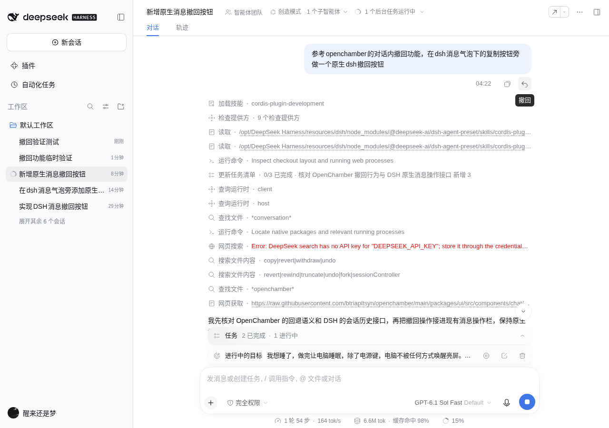
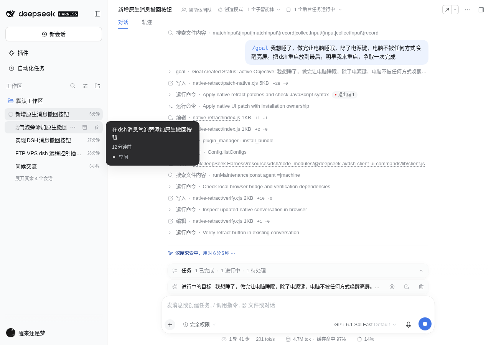

# dsh-native-retract · DSH 原生对话撤回

给 DSH（DeepSeek Harness）Web / Desktop 的**用户消息气泡**加一个原生「撤回」按钮，紧挨着原生「复制」按钮。

点一下就回到那条消息之前：消息本身和之后的所有对话从界面上消失、也不再进入模型的后续上下文，这条消息的文字自动放回输入框，可以直接改完再发。



参考 OpenChamber 的「对话内撤回」：**同一个 session、不新开分支**，原始事件日志完整保留，轨迹页（Trajectory）仍然能查到被撤回的每一步。

## 它做了什么

| | 行为 |
|---|---|
| 中止生成 | 正在跑的这一轮立刻取消 |
| 清空队列 | 丢弃尚未发送的排队消息 |
| 摘除区间 | 所选用户消息 `.seq` 到末尾（含当前 open turn）设为不可见 |
| 保留日志 | 原始事件不删除、不改写，仅做 surface 替换，可追溯、可回放 |
| 返回原文 | 所选消息的文本回到输入框并立即持久化草稿 |
| 不建分支 | 仍是同一个 sessionId，历史里没有分叉 |
| 不回滚文件 | 工作区文件、shell 副作用、子代理历史保持现状 |

## 安装

DSH 0.2.1-rc.2 验证通过。安装包目录只有编译产物、没有源码构建入口，所以本仓库采用的是
**「bundle 插件（Host 侧撤回逻辑） + 原生产物补丁（Client 侧按钮）」** 的组合：

```bash
# 1) 挂钩住。插件读取 DSH 的 Cordis profile
dsh profile install ./            # 或把本目录加入 profile 的 bundle 列表

# 2) 给原生客户端产物打按钮补丁（自动备份到 backups/）
node scripts/patch-native.cjs

# 3) 刷新页面 / 重启 Desktop
```

还原原生产物：

```bash
node scripts/patch-native.cjs --restore
```

自定义 DSH 安装位置：

```bash
DSH_NODE_MODULES=/path/to/node_modules/@deepseek-ai node scripts/patch-native.cjs
```

### 补丁改了哪两处

| 包 | 改动 |
|---|---|
| `@deepseek-ai/dsh-client-ui-chat` | `MessageIconActions` 增加 `onRetract` 按钮（复制之后、分支之前）；`UserMessageNodeView` 接上撤回动作，注入 `remote.commands` |
| `@deepseek-ai/dsh-client-ui-conversation` | 历史重放时过滤掉被撤回区间的记录，以及这次撤回自身产生的 command 行 |

补丁是**幂等**的：判断首行 `/* native-retract-v1 */` 标记，重复执行不会叠加；`backups/` 里永远是最初的原文件。

## Host 侧实现

`index.js` 注册一个 Cordis command `/native-retract <seq>`：

1. 校验 `seq` 指向一条 `user/message`、`surfaceOp === 'append'`、`source.kind === 'user'` 的事件；
2. 校验它仍在当前 surface 上（没被撤回、没被压缩替换掉）；
3. `agent.cancel()` + `whenIdle()`；
4. 在 `agent.runMaintenance()` 里追加一条空的 `user/message` 做 **surface replace**，区间是 `[seq, 末尾]`；
5. `ctx.sessions.flush(session)` 落盘，并把原文返回给 Client。

Cli 前端只通过 `ctx.remote.commands.execute()` 调这一个命令，没有第二套逻辑。

## 验证

```bash
# 单元/集成：边界、保留前缀、日志完整、模型上下文、草稿、重复撤回保护、后续新消息、UI 回放过滤
node scripts/test.mjs

# 真实 GUI：点击撤回 → 草稿恢复 → 页面刷新后仍隐藏
PLAYWRIGHT_MODULE=/path/to/playwright REMOTE_BASE=http://127.0.0.1:3080/myremote node scripts/e2e.cjs
```

端到端已核对：撤回按钮与原生复制按钮紧邻、无页面 JS 异常、点击后草稿恢复为上一条原文、刷新后消息仍不可见且草稿保留。



## 已知边界

- 只恢复**文本**，不自动恢复图片、文件附件与引用 chip；
- 不回滚工作区文件、shell 副作用、子代理历史；
- 没有 Restore / redo 暂存条（撤销即重发）；
- 若目标消息已被压缩替换，会明确报错而不是冒险改写历史；
- 撤回会清空待发送队列。

## 升级注意

补丁作用在 DSH 安装包的**编译产物**上，DSH 升级后 `client.js` 会被覆盖：

1. `node scripts/patch-native.cjs --restore`（或直接删掉 `backups/` 里的旧备份）；
2. 重新执行 `node scripts/patch-native.cjs`；
3. 若锚点不匹配，脚本会**直接报错并指出缺失的锚点**，不会写出半成品文件。

本仓库不是对 DSH 官方仓库的修改版本，只做本机安装前的产物补丁，方便 DSH 升级后重新适配。

## License

MIT © 2026 emocow-liuyun
